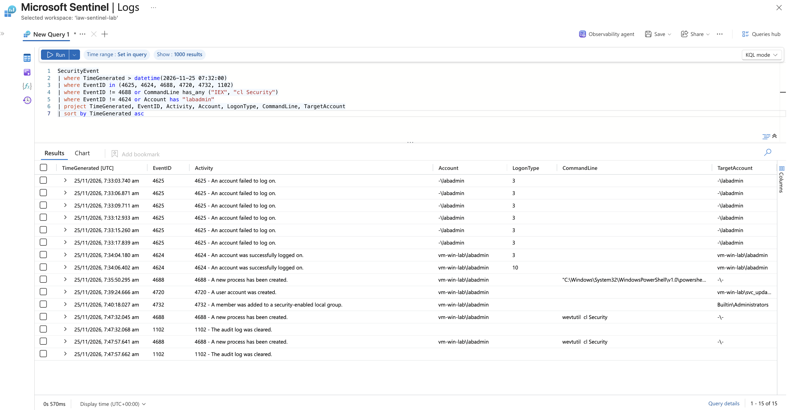
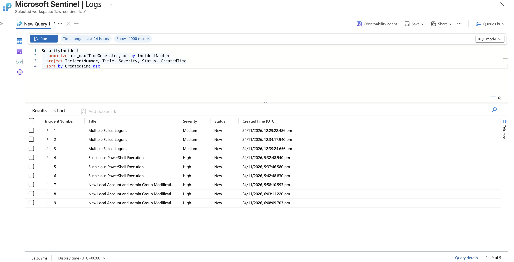
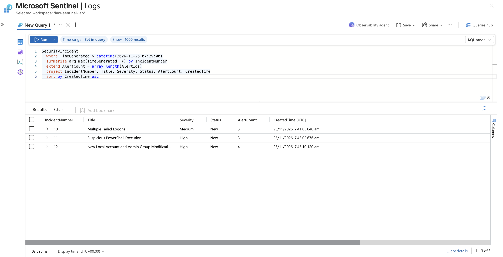
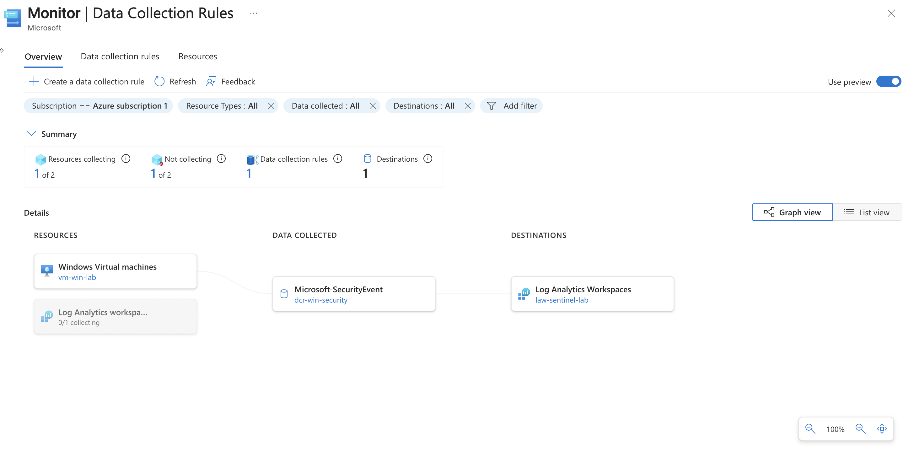
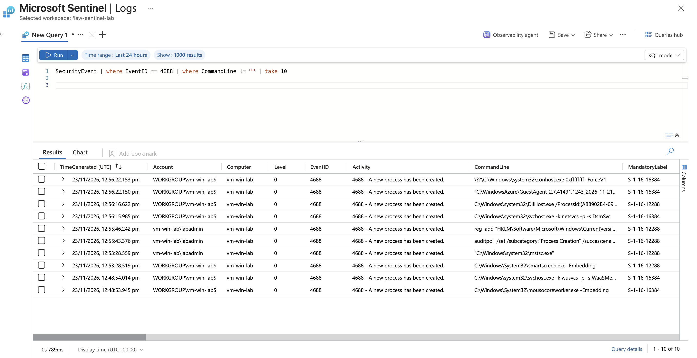
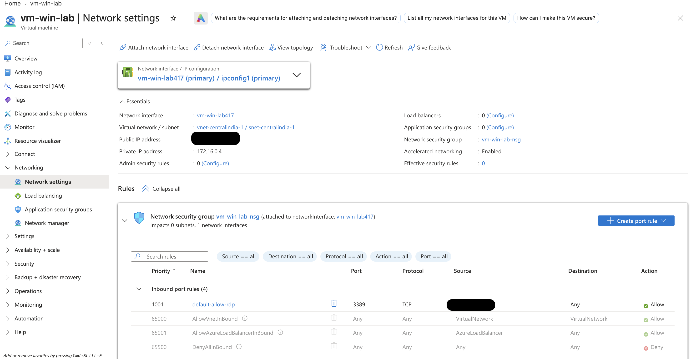

# Microsoft Sentinel SOC lab

A small Sentinel lab I built to practise detection and triage for a SOC analyst role. I sent Windows Security events from one Azure VM into Sentinel, wrote three analytics rules, ran controlled tests against them, and wrote up what the logs show.

I ran every test myself. Nothing here is a real attack.

## What the lab shows

- One test chain on a VM: failed logons then a success, a PowerShell IEX command, a new local admin account, and the Security log cleared. The timeline is below.
- Three analytics rules. Each has a query file in `detections/` and notes on where it is weak.
- A tuning before and after. Each test created 3 incidents at first. After grouping alerts, each rule created 1 incident.
- Four investigation write-ups. The verdicts come from the logs and not from the fact that I ran the tests. One of them is an escalation.

## Tools

Microsoft Sentinel, a Log Analytics workspace, the Azure Monitor Agent with a data collection rule, an Azure VM running Windows Server 2022, KQL, and Windows Security event logs. I mapped the behaviours to MITRE ATT&CK.

## How I investigate an incident

1. Open the incident and note the rule, severity, time and entities.
2. Pull the raw events from SecurityEvent for that account and host around that time.
3. Read the event details: logon type, failure codes, command line, parent process and SIDs.
4. Compare what happened with what I would expect from that account.
5. Decide a verdict, write down the next step, and note what the rule missed.

## Setup

- Azure free account, resource group in Central India.
- Log Analytics workspace with Microsoft Sentinel turned on.
- One Windows Server 2022 VM (Standard B2s_v2).
- A data collection rule that sends all Windows Security events to the workspace.
- Process creation auditing with command line logging turned on, so 4688 events show the full command.
- RDP allowed from one IP address only.

The data path:

```
Windows Server 2022 VM > Azure Monitor Agent > data collection rule > Log Analytics workspace > Microsoft Sentinel > analytics rules > alerts > incidents
```

Screenshots of the setup are at the end of this page.

## Detections

All three run every 5 minutes with a 15-minute lookback. The rule queries are in `detections/`, and [detections/README.md](detections/README.md) says what each one looks for and where it is weak. The evidence queries are in [kql-notes.md](kql-notes.md).

- [Multiple Failed Logons](detections/01-multiple-failed-logons.kql) (medium): 5 or more 4625 events for one account and source.
- [Suspicious PowerShell Execution](detections/02-suspicious-powershell.kql) (high): 4688 events where powershell.exe has IEX, encoded commands or download cmdlets in the command line.
- [New Local Account and Admin Group Modification](detections/03-new-local-admin.kql) (high): a 4720 event, or a 4732 event on the Administrators group.

MITRE ATT&CK mapping, with the evidence for each technique in [mitre-mapping](mitre-mapping/README.md):

- Multiple failed logons (4625): T1110 Brute Force.
- PowerShell with IEX or download terms (4688): T1059.001 PowerShell.
- New local account added to Administrators (4720, 4732): T1136.001 Local Account and T1098 Account Manipulation.
- Security log cleared (1102, no rule yet): T1070.001 Clear Windows Event Logs.

## Test run

On 25 Nov 2026 I ran one chain on the VM, in this order:

1. Six wrong passwords at the RDP login, then the correct one.
2. A PowerShell command with IEX.
3. A new local account, added to Administrators.
4. The Security log cleared with `wevtutil cl Security`, run twice.



I wrote one investigation for each of the first three steps and one for the log clearing:

- [Failed logons followed by a success](investigations/01-failed-logons-then-success.md)
- [PowerShell IEX command](investigations/02-suspicious-powershell.md)
- [New local admin account](investigations/03-new-local-admin-account.md)
- [Security log cleared](investigations/04-security-log-cleared.md)

## Tuning

On 24 Nov each rule created 3 incidents from a single test, about 5 minutes apart. With a 5-minute schedule and a 15-minute lookback, each event falls inside three runs.



I turned off suppression on Rule 1, set up entity mapping on all three rules, and turned on alert grouping. On 25 Nov each rule created one incident. The alert counts are 3, 3 and 4, so the rules still fire several times and grouping merges them.



Time from the last event to the incident was about 8 minutes for failed logons, 7 for PowerShell and 5 for the admin account.

I also changed two queries. Rule 1 now counts across the whole lookback instead of fixed 5-minute blocks, and Rule 3 now ignores groups other than Administrators.

## Limits

- One VM, one account, and tests I ran myself. There is no normal traffic to measure false positives against.
- Event 4688 shows that a process started. It does not show what the process did. I have no network logs.
- Rule 1 only detects the failures. I found the successful logon with a separate query.
- No rule covers event 1102. I found the log clearing by query.
- The overlapping runs still create repeat alerts. Setting the lookback closer to the schedule would reduce them. I did not test that.

## Contents

- `detections/` has the three rule queries and a page on each rule.
- `investigations/` has the four write-ups.
- `mitre-mapping/` has the technique mapping with evidence.
- `kql-notes.md` has the rule notes and the evidence queries.
- `screenshots/` has the images used on these pages.

## Setup screenshots






