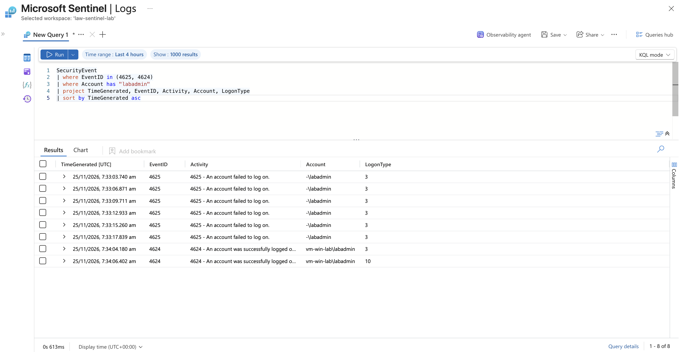

# Incident 01: failed logons followed by a successful logon

Detection: Multiple Failed Logons (medium). Incident created 25 Nov 2026 at 07:41:05 UTC. Three alerts from overlapping rule runs were grouped into this one incident.

## What the logs show

- Six failed logons (4625) for labadmin between 07:33:03 and 07:33:17 UTC, all inside 14 seconds.
- All six are logon type 3, which is how RDP with network level authentication shows up before a session opens.
- All six failures have the same codes. Status 0xc000006d is a generic logon failure. SubStatus 0xc000006a means the account name exists and the password was wrong. The authentication package is NTLM.
- A successful logon (4624) for the same account at 07:34:04, type 3, about 46 seconds after the last failure. Two seconds later a type 10 logon appeared. Type 10 is a remote interactive session, so someone got a desktop.

## Reading

Six wrong passwords in 14 seconds against a real account name, then a success. The SubStatus codes confirm the account name was valid on every attempt, so whoever typed it knew the username. That is what password guessing looks like when it works. It is also what a person who forgot their password looks like. The logs alone do not separate the two.

The source address is the same in all eight events (six failures and two successes). One address for the whole sequence fits a single person or a single tool. It does not say which.

## Verdict

Suspicious, escalate. Treat labadmin as possibly compromised until the owner confirms the logon. The success after the failures is what makes this more than a routine failed-logon alert.

## Next steps

- Check whether the shared source address is one the owner uses.
- Ask the owner if they logged in around 07:34.
- If they did not, reset the password and end the session.

## Gaps

The rule only counts failures. I found the success with a separate query, so the alert by itself would not tell an analyst that the guessing worked.

Detection took about 8 minutes, from the last failure at 07:33:17 to the incident at 07:41:05.

Note: I ran this test myself. I typed a wrong password six times on purpose and then the right one. The shared source address is my own.
