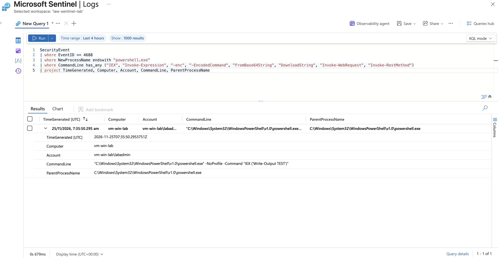

# Incident 02: PowerShell IEX command

Detection: Suspicious PowerShell Execution (high). Incident created 25 Nov 2026 at 07:43:02 UTC. Three alerts were grouped into this incident.

## What the logs show

- At 07:35:50 UTC labadmin started powershell.exe with the command line `-NoProfile -Command "IEX ('Write-Output TEST')"` (4688). The parent process was another powershell.exe.
- This was 1 minute 44 seconds after the RDP session opened at 07:34:06.
- IEX runs a string as code. Here the string is a plain Write-Output. There is no URL, no encoded text and no download call.
- Event 4688 shows that a process started. It does not show what the process did afterwards, and I have no network logs in this lab. I have no evidence of a download.

## Reading

The command matched the rule because it contains IEX. The content is harmless. What makes it worth a second look is the timing. It ran about two minutes after a logon that followed failed logons, and a new local admin account appeared 3 minutes 34 seconds later.

## Verdict

Harmless on its own, suspicious in context. I would keep this incident open and link it to incidents 10 and 12 instead of closing it. High severity is too high for this command alone. Medium fits better.

## Gaps

- The rule matches terms in the command line. `-enc` is read as the term enc, and short forms like `-e` and `-ec` are not matched.
- Detection took about 7 minutes (07:35:50 to 07:43:02).

Note: I ran this command myself as a test.
