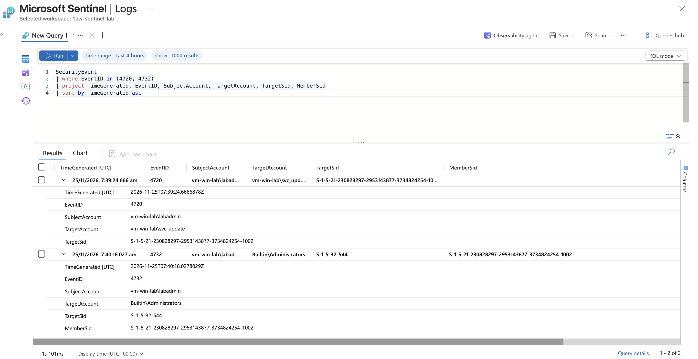

# Incident 12: new local account added to Administrators

Detection: New Local Account and Admin Group Modification (high). Incident created 25 Nov 2026 at 07:45:10 UTC. Four alerts were grouped into this incident.

## What the logs show

- At 07:39:24 UTC labadmin created a local account named svc_update (4720).
- At 07:40:18, about 53 seconds later, labadmin added a member to Builtin\Administrators (4732).
- MemberName is empty on the 4732 event, so I matched on the SID. The SID of the new account and the SID of the added member both end in -1002. It is the same account.
- The account was created 3 minutes 34 seconds after the PowerShell command in incident 11 and about 5 minutes after the logon in incident 10.

## Reading

A new account with admin rights is a way to keep access after the original password is changed. The name svc_update looks like a service account, so it could pass for one in a list of users. It was created by hand in a session that began with failed logons.

## Verdict

True positive for persistence. This is the most serious of the three detection incidents. I would disable svc_update, remove it from Administrators, and ask the owner of labadmin whether they created it. A change ticket for it would change the verdict.

## Gaps

- The rule fires only for 4720 and for 4732 on the Administrators group. Adds to other groups are ignored on purpose, because Windows adds every new account to Users automatically.
- Detection took about 5 minutes after the group change (07:40:18 to 07:45:10).

Note: I created this account myself as a test.
