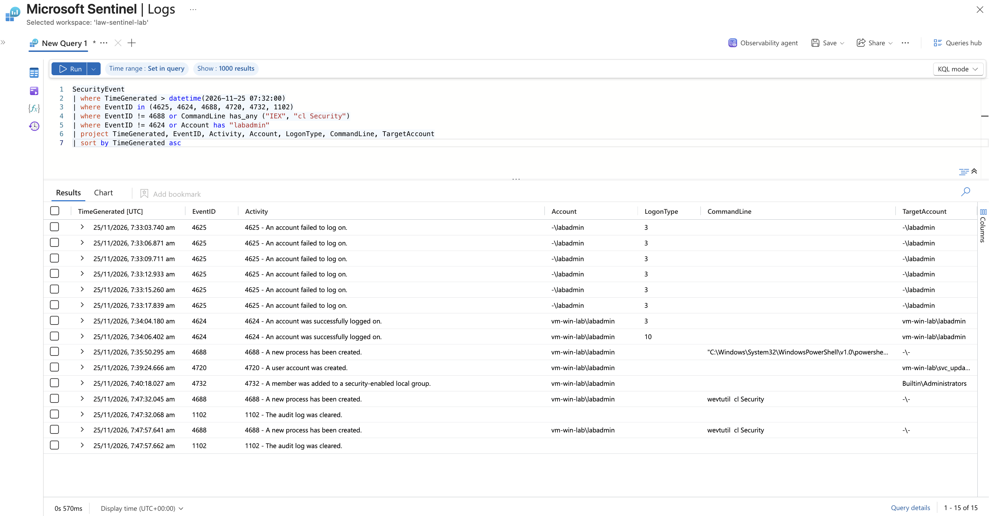

# Security log cleared (found by query, no incident)

I have no rule for this activity, so no incident exists. I found it by querying for event 1102 and for `cl Security` in process command lines.

## What the logs show

- Two 4688 events for `wevtutil cl Security` by labadmin, at 07:47:32 and 07:47:57 UTC.
- Each one is followed about 20 milliseconds later by a 1102 event (The audit log was cleared).
- The 1102 events have no account in Sentinel, so I tied them to labadmin through the 4688 event right before each one.
- This was 7 minutes 14 seconds after labadmin was added to Administrators.
- The events from before the clear are still in Sentinel. That is why I can build the timeline at all.

## Reading

Clearing the Security log is a way to remove evidence. It has few normal reasons on a server. The command ran twice, 25 seconds apart.

My first version of the timeline query matched any `wevtutil` process. It returned 14 extra rows between 07:30:49 and 07:30:51, while the VM was booting. They came from the Azure guest agent and Windows Defender and ran under the VM's own account, not labadmin. A rule on the word `wevtutil` would fire on every boot. The `cl Security` argument, or event 1102, is the signal worth alerting on.

## Verdict

High concern, and the last step of the chain: failed logons, successful logon, PowerShell, new admin account, log cleared. I would treat the whole chain as one incident on one host and escalate it. The MITRE technique is T1070.001, Clear Windows Event Logs.

## Gaps

- No analytics rule covers event 1102. A rule on 1102 would have flagged it. I have not built one.
- The local log is gone for anything before 07:47. Only the copy in Sentinel remains.

Note: I ran the command twice myself as a test.
